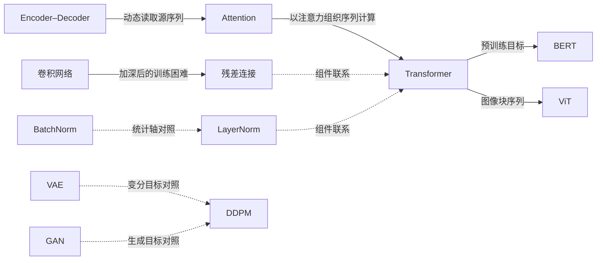

# 深度学习经典论文精读与技术演进路线

Deep Learning Papers Reading Roadmap · 中文解读 · 论文关联 · 可验证实验

读懂一个方法解决了什么问题，再通过小实验检验自己的理解。本项目从经典深度学习出发，连接注意力、Transformer 与扩散模型；重点是学习路径和证据，而不是 PDF 数量。

## 从这里开始

| 你的目标 | 阅读入口 | 学习产出 |
|---|---|---|
| 第一次系统读论文 | [起步与核心路线](docs/roadmaps/README.md) | 区分原论文证据、自己的解释和实验结论 |
| 理解网络为什么能训练 | [训练与视觉](docs/roadmaps/training-and-vision.md) | 解释残差、归一化和优化器各自解决的问题 |
| 从序列模型走向 Transformer | [序列与注意力](docs/roadmaps/sequence-and-attention.md) | 手算注意力并检查因果掩码 |
| 从潜变量走向扩散模型 | [生成模型](docs/roadmaps/generative-models.md) | 验证加噪分布和预测噪声 |
| 查找原来收录的资料 | [历史资料入口](docs/archive/README.md) | 找到原 PDF 或旧清单中的外部链接 |

先修：Python、向量与矩阵、导数与链式法则、均值与方差。生成路线还需要条件概率、期望和 KL 散度。

## 第一批精读与实验

| 论文 | 中文精读 | 机制实验 | 验证边界 |
|---|---|---|---|
| ResNet（2015 预印本 / CVPR 2016） | [残差改变了什么](notes/resnet.md) | `residual` | 标量网络的输入导数 |
| BatchNorm（2015） | [统计量从哪里来](notes/batch-normalization.md) | `normalization` | 二维输入的训练态归一化 |
| LayerNorm（2016） | [不依赖同批样本](notes/layer-normalization.md) | `normalization` | 统计轴和批次依赖对照 |
| Adam（2014 预印本 / ICLR 2015） | [从梯度到参数更新](notes/adam.md) | `adam` | 二维二次函数上的优化轨迹 |
| Transformer（2017） | [Q、K、V 与信息可见性](notes/transformer.md) | `attention` | 单头前向与未来信息隔离 |
| DDPM（2020） | [加噪与预测噪声](notes/ddpm.md) | `diffusion` | 一维高斯加噪与线性去噪 |

这些是教学用机制验证，**尚未完成原论文数据集、模型规模和指标复现**。扩展论文的精读状态见 [论文索引](docs/papers.md)。

## 五分钟跑通实验

Python 3.10+，仅使用标准库，无须 GPU、下载数据或安装第三方包。在仓库根目录运行：

```bash
python3 experiments/run.py --experiment all --seed 7 --output /tmp/roadmap-results.json
python3 -m unittest discover -s experiments -p 'test_*.py' -v
python3 scripts/check_content.py
```

每项实验输出参数、指标和通过条件，失败返回非零状态。详见 [实验说明](experiments/README.md) 与 [实测报告](experiments/results/README.md)。

## 论文之间怎么连接



箭头表示问题延续、组件联系或教学对照，不表示所有论文之间都有直接继承关系，也不表示后者全面优于前者。详见 [技术演进与关联](docs/connections.md)。

## 目录与维护

```text
docs/roadmaps/      学习路线、先修关系与验收标准
docs/papers.md      论文索引、状态与一手来源
docs/connections.md 技术关系及边界
notes/             中文精读：问题、方法、证据、局限、实验
experiments/       可运行脚本、语义测试与实测记录
scripts/           本地链接与内容完整性检查
templates/         精读和实验报告模板
docs/archive/      历史清单与旧目录索引
1.0-Book/ … 4.0-Other/  原有资料目录，保留旧路径
```

原资料区保留 112 个 PDF；新内容优先引用作者、会议或 arXiv 页面。历史文献的版权属于各自权利人。旧条目的“暂无”指旧收录状态，不表示论文无法取得。

贡献前阅读 [维护规范](CONTRIBUTING.md)。后续选题见 [维护计划](docs/maintenance.md)，旧表述修正见 [勘误](docs/errata.md)。
