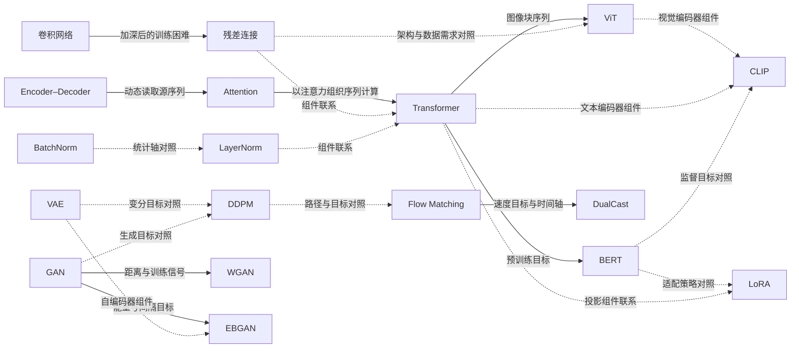

# 技术演进与论文关联

[首页](../README.md) · [论文原文索引](papers.md)

这里的关系是教学组织，不把所有箭头解释为作者之间的直接引用或历史首创认定。

| 起点 → 终点 | 关系类型 | 如何理解 | 不应推断 |
|---|---|---|---|
| [AlexNet](../topics/03-vision/notes/alexnet.md) ↔ [Dropout](../topics/02-training/notes/dropout.md) | 组件与实例 | 在全连接隐藏层追踪训练掩码与推理缩放 | 所有子网的最终预测都能由缩放精确平均 |
| [VGG](../topics/03-vision/notes/vgg.md) ↔ [GoogLeNet](../topics/03-vision/notes/googlenet.md) | 架构对照 | 串联小核与多尺度分支拼接形成不同计算路径 | 相同输出尺寸意味着相同计算量 |
| [word2vec](../topics/04-language/notes/word2vec.md) → [Seq2Seq](../topics/04-language/notes/seq2seq.md) | 输入表示 | 对照邻词监督与译文监督如何更新查表向量 | 原翻译模型使用了预训练词向量 |
| [VGG](../topics/03-vision/notes/vgg.md) → ResNet | 问题延续 | 网络更深之后，训练难度成为关键问题之一 | ResNet 只是增加层数 |
| BN ↔ LN | 方法对照 | 归一化统计范围从批次对照到单样本特征；BN 同批样本间 Jacobian 耦合对照 LN 样本内特征耦合 | LN 在每个任务都优于 BN |
| [Seq2Seq](../topics/04-language/notes/seq2seq.md) → [Bahdanau Attention](../topics/04-language/notes/bahdanau-attention.md) | 信息读取方式 | 每个解码步骤动态聚合源端表示 | 有注意力就不再需要序列编码器 |
| [Bahdanau Attention](../topics/04-language/notes/bahdanau-attention.md) → Transformer | 计算组织变化 | 从递归模型中的注意力走向主要依靠注意力的序列架构 | 两者注意力打分函数完全一样 |
| ResNet / LN → Transformer | 组件联系 | 残差连接与层归一化用于子层组织；按 token 归一化不撤销注意力引入的上下文依赖 | 相同组件就保证相同训练性质 |
| [Transformer](../topics/04-language/notes/transformer.md) → [BERT](../topics/04-language/notes/bert.md) | 预训练任务 | 双向可见性、输入扰动和监督位置是三个不同选择；固定 logits 的标签/padding 干预已有验证 | 去掉因果掩码就复现了 BERT，或 MLM 等于下一词预测 |
| [Transformer](../topics/04-language/notes/transformer.md) → [ViT](../topics/03-vision/notes/vit.md) | 输入表示迁移 | 图像块投影构成连续 token；区分只换内容与内容/位置联合重排 | 数组排列本身就给注意力提供空间标签 |
| [ResNet](../topics/03-vision/notes/resnet.md) ↔ [ViT](../topics/03-vision/notes/vit.md) | 架构与数据需求对照 | 局部卷积先验对照图像块上的全局注意力；结合预训练规模与预算读结果 | ViT 在任何数据规模、训练配方下都优于 CNN |
| [ViT](../topics/03-vision/notes/vit.md) / Transformer → [CLIP](../topics/07-multimodal/notes/clip.md) | 组件联系与监督目标 | 双编码器输出归一化向量，以双向交叉熵学习配对；同步置换保留标签关系 | CLIP 等同于 ViT，或图文匹配就是交叉注意力 |
| [BERT](../topics/04-language/notes/bert.md) ↔ [CLIP](../topics/07-multimodal/notes/clip.md) | 目标对照 | token 标签的 MLM 对照批内图文配对索引；候选文本改变分类接口 | 共用 Transformer 就具有相同预训练任务，或 CLIP 本身生成图像 |
| [BERT](../topics/04-language/notes/bert.md) ↔ [LoRA](../topics/10-transfer/notes/lora.md) | 适配策略对照 | 全参数微调对照冻结基础权重、学习任务增量；不改变预训练目标的定义 | 低秩增量意味着基础模型被压缩，或冻结权重就能停止输入梯度 |
| Transformer → [LoRA](../topics/10-transfer/notes/lora.md) | 组件联系 | 选择注意力投影等线性层学习增量；合并要求确定性的线性分支 | 训练态 dropout 或合并后仍开启分支也自动等价 |
| [Adam](../topics/02-training/notes/adam.md) → [AdamW](../topics/02-training/notes/adamw.md) | 优化与正则化 | 衰减不进入一阶/二阶矩；比较实现前统一学习率与衰减系数约定 | L2 与解耦衰减总等价，或解耦后衰减量就与学习率无关 |
| [VAE](../topics/05-generative/notes/vae.md) ↔ [DDPM](../topics/05-generative/notes/ddpm.md) | 概率建模对照 | 学习近似后验与固定前向加噪链的变分目标对照 | DDPM 只是给 VAE 更换编码器 |
| [VAE](../topics/05-generative/notes/vae.md) → [输入跳跃](../topics/05-generative/notes/vae-input-skip.md) | 评价问题延续 | 先写出归一化似然，再区分重构坐标与生成分布 | MSE 降低必然改善生成质量 |
| Adam → [输入跳跃](../topics/05-generative/notes/vae-input-skip.md) | 优化联系 | 等价参数表示可能具有不同更新轨迹；训练部分未本地验证 | 分布等价就保证重新训练结果相同 |
| [GAN](../topics/05-generative/notes/gan.md) → [EBGAN](../topics/05-generative/notes/ebgan.md) | 目标与组件变化 | 自编码重构能量与间隔目标，重新解释两方更新 | 单方最优就保证联合均衡 |
| [WGAN](../topics/05-generative/notes/wgan.md) ↔ [EBGAN](../topics/05-generative/notes/ebgan.md) | 方法对照 | Lipschitz critic 对照非负能量与间隔 | 实值输出就意味着相同距离或约束 |
| [VAE](../topics/05-generative/notes/vae.md) ↔ [EBGAN](../topics/05-generative/notes/ebgan.md) | 组件联系 | 编码器和解码器分别服务于变分目标与对抗能量 | 共用自编码结构就具有相同概率解释 |
| [GAN](../topics/05-generative/notes/gan.md) → [WGAN](../topics/05-generative/notes/wgan.md) | 问题延续 | 从 JS 对照运输距离，明确 critic 的函数约束、容量和优化程度 | 任意 critic 差值就是精确运输距离 |
| [GAN](../topics/05-generative/notes/gan.md) ↔ [DDPM](../topics/05-generative/notes/ddpm.md) | 生成目标对照 | 学习中的判别器提供梯度，对照已知加噪过程构造的监督 | 局部梯度大小能决定完整训练的优劣 |
| [VAE](../topics/05-generative/notes/vae.md) ↔ [GAN](../topics/05-generative/notes/gan.md) | 目标与评价对照 | ELBO 与对抗目标分别分析，区分密度评价、质量与覆盖 | 恒定判别器输出 1/2 就证明分布匹配 |
| [DDPM](../topics/05-generative/notes/ddpm.md) ↔ [Flow Matching](../topics/05-generative/notes/flow-matching.md) | 方法对照 | 从噪声目标读到显式路径与速度目标；FM 也允许扩散路径 | 所有速度回归都有相同路径或采样成本 |
| [Flow Matching](../topics/05-generative/notes/flow-matching.md) → [DualCast](../topics/05-generative/notes/dualcast.md) | 方法前置 | 线性插值与条件速度；应用中反转时间轴并添加参考条件和区域监督 | 沿用速度损失就已经复现视频模型 |
| [WGAN](../topics/05-generative/notes/wgan.md) ↔ [Flow Matching](../topics/05-generative/notes/flow-matching.md) | 运输概念对照 | Wasserstein-1 critic 对照条件高斯的 Wasserstein-2 位移插值 | 条件最优推出边缘流全局最优 |

关系依据分别来自对应原论文的方法段落；精读页给出具体章节。表中的阅读顺序和“不应推断”是本项目的教学解释。

VAE / CLIP → [DualCast](../topics/05-generative/notes/dualcast.md) 属于组件联系，分别构造潜变量条件与视觉上下文。DDPM ↔ DualCast 属于目标对照，阅读时核对噪声预测与速度预测的定义。

## 预训练的信息路径与生成器控制

| 对读 | 关系及可追踪的差别 |
|---|---|
| [ELMo](../topics/04-language/notes/elmo.md) ↔ [GPT-1](../topics/04-language/notes/gpt-1.md) | 迁移接口对照。前者把不同层的前后向状态作为下游特征，后者将标签梯度传回单向主干。 |
| [Transformer](../topics/04-language/notes/transformer.md) → [Transformer-XL](../topics/04-language/notes/transformer-xl.md) → [XLNet](../topics/04-language/notes/xlnet.md) | 组件承接。先在键值端接入带相对距离的段缓存，再通过双流分别处理可见内容和待预测位置。 |
| [BERT](../topics/04-language/notes/bert.md) ↔ [XLNet](../topics/04-language/notes/xlnet.md) ↔ [T5](../topics/04-language/notes/t5.md) | 目标对照。分别在受扰动输入上分类、沿排列条件分解词概率、从缺段输入生成带哨兵的标签。 |
| [GAN](../topics/05-generative/notes/gan.md) → [StyleGAN](../topics/05-generative/notes/stylegan.md) | 保留对抗学习，用中间潜码逐层调节通道统计，另设局部噪声入口。 |

## 关系概览

实线表示问题延续或应用方向，虚线表示组件联系或教学对照。具体含义与边界以上表为准。

## 用同一组问题比较论文

1. 输入、输出和训练监督分别是什么？
2. 哪个算子、目标或参数化发生变化？
3. 保持不变的对照条件有哪些？
4. 结论是在训练速度、泛化、生成质量，还是计算成本上成立？
5. 我们的小实验隔离了哪个因素，还有什么没有验证？

例如比较 BN/LN 时先固定输入和仿射参数，仅改变统计轴；比较视觉架构时若训练数据、增强、算力同时改变，就不能直接作单因素归因。

Flow Matching 与 WGAN 的教学对照还需区分距离评价和模型表达能力：[双峰补充](../topics/05-generative/notes/flow-matching.md)中均值、方差可匹配而两个峰区间的概率质量仍错误；这不构成两种训练算法的优劣排名。

[Flow Matching](../topics/05-generative/notes/flow-matching.md) → [Robust Flow Matching](../topics/05-generative/notes/robust-flow-matching.md) 是监督可靠性的问题延续；[DualCast](../topics/05-generative/notes/dualcast.md) 与后者是区域重要性加权和样本可靠性加权的对照，不能将两类权重解释为同一机制。

[Adam](../topics/02-training/notes/adam.md) 与 [Robust Flow Matching](../topics/05-generative/notes/robust-flow-matching.md) 的 EMA 仅属组件对照：前者按参数更新矩，后者按样本访问更新可靠性分数；未访问样本不应随全局步衰减。[缓冲区验证](../experiments/results/trs-buffer.md)。

[Flow Matching](../topics/05-generative/notes/flow-matching.md) → [LipsFlower](../topics/05-generative/notes/lipsflower.md) 是速度学习到输入敏感性的**问题延续**；[Robust Flow Matching](../topics/05-generative/notes/robust-flow-matching.md) ↔ LipsFlower 是训练污染与推理扰动的**问题对照**；[WGAN](../topics/05-generative/notes/wgan.md) ↔ LipsFlower 是 critic 与速度场函数约束的**概念对照**，不能推断相同损失或直接继承。

[Flow Matching](../topics/05-generative/notes/flow-matching.md) → [直线性与 Euler 误差](../topics/05-generative/notes/flow-straightness.md) 是回归到数值求解的**问题延续**；与 [LipsFlower](../topics/05-generative/notes/lipsflower.md) 是观测扰动与离散误差的**来源对照**。与 [WGAN](../topics/05-generative/notes/wgan.md) 是分布距离和同场终点误差的**评价对照**，不能互换验收指标。

[Flow Matching](../topics/05-generative/notes/flow-matching.md) 的条件均值 → [势流专题](../topics/05-generative/notes/flow-straightness.md) 是**公式与归纳偏置联系**：二维高斯使 Jacobian 的对称性可直接检查；各向异性并不必然有旋，必须看源与目标的协方差关系。

[ResNet](../topics/03-vision/notes/resnet.md) ↔ [BatchNorm](../topics/02-training/notes/batch-normalization.md) 是**组件与问题对照**：原文普通网络已有 BN，退化不宜直接归因于梯度消失。ResNet → [Transformer](../topics/04-language/notes/transformer.md) 的残差联系也需核对加法后激活与归一化顺序，不能直接沿用 D(I+J_F)。

## 骨干、候选框与多尺度特征

| 对读 | 关系与可观察的区别 |
|---|---|
| [ResNet](../topics/03-vision/notes/resnet.md) 与 [DenseNet](../topics/03-vision/notes/densenet.md) | 块内传递方式的对照。残差相加保持同宽，稠密拼接让后层卷积按来源通道取值。 |
| DenseNet 与 [MobileNet v1](../topics/03-vision/notes/mobilenet-v1.md) | 同为分类骨干。前者的瓶颈投影限制后续卷积宽度，后者的逐点卷积混合逐通道滤波的结果。 |
| [Faster R-CNN](../topics/06-detection-segmentation/notes/faster-rcnn.md) 与 [SSD](../topics/06-detection-segmentation/notes/ssd.md) | 都用相对参考框的回归；RPN 的物体性分数用于选候选，SSD 的类别分数直接参与最终筛选。 |
| ResNet、Faster R-CNN 与 [FPN](../topics/06-detection-segmentation/notes/fpn.md) | 组件组合。骨干提供 C2–C5；FPN 融合跨层特征；RPN 和区域分类器消费不同尺度。 |
| [U-Net](../topics/06-detection-segmentation/notes/u-net.md) 与 FPN | 空间细节恢复的对照。前者跨尺度对齐后拼接，再预测像素；后者投影后相加，供多个尺度上的检测头读取。 |

## 比较监督来自哪里

| 方法对照 | 具体变化 | 验证问题 |
|---|---|---|
| [MoCo](../topics/03-vision/notes/moco.md) ↔ [SimCLR](../topics/03-vision/notes/simclr.md) ↔ [CLIP](../topics/07-multimodal/notes/clip.md) | 候选来自历史键、同批图像视图或同批另一模态 | 固定批量后有哪些负例仍可参与？ |
| MoCo → [BYOL](../topics/03-vision/notes/byol.md)（组件对照） | 慢目标从编码字典键变成同图另一视图的回归目标 | 对齐损失怎样响应所有图像取同一向量？ |
| [ViT](../topics/03-vision/notes/vit.md) ↔ [Swin](../topics/03-vision/notes/swin.md) / [MAE](../topics/03-vision/notes/mae.md) | 移窗改变层间可达性，遮挡改变送入编码器的位置 | 同样缩小注意力矩阵，哪个方法仍保留全图位置？ |
| [Transformer](../topics/04-language/notes/transformer.md) → [GPT-3](../topics/04-language/notes/gpt-3.md) | 因果解码器扩展到多个模型规模，以前缀示例传入任务 | 同一权重增加示例与同一提示扩大模型分别控制了什么？ |

## 从基础组件到训练与适配

- **预算与实现**。[Chinchilla](../topics/04-language/notes/chinchilla.md) 固定总 FLOPs 比较模型规模；[FlashAttention](../topics/02-training/notes/flashattention.md) 固定 Transformer 的注意力输出，改变中间张量读写。同一训练预算映射到耗时还取决于算子和硬件。
- **表示与条件**。[LDM](../topics/05-generative/notes/latent-diffusion.md) 将 [DDPM](../topics/05-generative/notes/ddpm.md) 的加噪目标移至压缩网格，并用交叉注意力从文本读取条件。
- **偏好目标**。[InstructGPT](../topics/04-language/notes/instructgpt.md) 的比较奖励与参考策略，在 [DPO](../topics/04-language/notes/dpo.md) 中被写成两个序列的相对对数概率差。
- **存储与更新**。[QLoRA](../topics/10-transfer/notes/qlora.md) 沿用 [LoRA](../topics/10-transfer/notes/lora.md) 的可训练低秩分支，将冻结基座改为块量化存储。

## 基础模型、后训练与离散生成

| 论文 | 关系 | 可以核对的区别 |
|---|---|---|
| [Transformer](../topics/04-language/notes/transformer.md) 与 [Mamba-2](../topics/04-language/notes/mamba-2.md) | 算子对照 | SSD 的历史混合系数可分为内容内积和跨步衰减积，跨块由有限维状态传递。 |
| [DeepSeek-V3](../topics/04-language/notes/deepseek-v3.md) → [R1](../topics/04-language/notes/deepseek-r1.md) | 实际使用的基础模型 | 从 V3-Base 出发，组内相对奖励改变策略更新；专家路由仍属前向计算。 |
| [R1](../topics/04-language/notes/deepseek-r1.md) 与 [Qwen3](../topics/04-language/notes/qwen3.md) | 蒸馏配方对照 | 静态教师轨迹与学生采样前缀上的教师分布覆盖不同的上下文。 |
| [BERT](../topics/04-language/notes/bert.md) 与 [LLaDA](../topics/05-generative/notes/llada.md) | 监督位置对照 | LLaDA 用多噪声水平的掩码损失配合反向采样，自全掩码生成。 |
| [LLaDA](../topics/05-generative/notes/llada.md) 与 [Janus-Pro](../topics/07-multimodal/notes/janus-pro.md) | 离散生成对照 | 多轮揭晓词位与逐个生成图像码的条件集合不同；Janus-Pro 的理解路径另用语义编码器。 |

## 从输入对齐到位置输出

[Bahdanau Attention](../topics/04-language/notes/bahdanau-attention.md) 与 [Pointer Networks](../topics/08-memory/notes/pointer-networks.md) 共享加性位置打分。前者用权重汇集源句信息，后者直接用目标位置监督打分，输出类别数随当前样本改变。

## 检测与跟踪中的多分辨率特征

[FPN](../topics/06-detection-segmentation/notes/fpn.md) 与 [C-COT](../topics/11-tracking/notes/c-cot.md) 构成方法对照。沿两者的数据路径寻找求和的位置：FPN 合并经对齐的特征图，保留多个检测层级；C-COT 累加各通道对位移的响应，求同一目标的位置。

## 两种强化学习方法中的“优势”

[Dueling Networks](../topics/09-rl-robotics/notes/dueling-networks.md) 与 [DeepSeek-R1](../topics/04-language/notes/deepseek-r1.md) 可作方法对照。前者在同一状态的动作维度上中心化网络输出，再重建 Q 值；后者在同一问题的采样回答组内比较奖励，为策略更新提供相对信号。

## 学生从教师得到什么信息

[经典知识蒸馏](../topics/10-transfer/notes/knowledge-distillation.md) 与 [DeepSeek-R1](../topics/04-language/notes/deepseek-r1.md) 构成监督方式对照。前者匹配分类器给出的整个类别分布，后者的小模型在教师生成的轨迹上做监督学习。只有前一种输入直接给出未被选中类别的相对概率。

[Policy Distillation](../topics/10-transfer/notes/policy-distillation.md) 接续上述软目标构造，用教师动作价值形成目标分布。结合 [Dueling Networks](../topics/09-rl-robotics/notes/dueling-networks.md) 可验证：同一状态中所有动作共享的价值偏移会在教师 softmax 中抵消，动作差距与温度的比值决定赔率。
