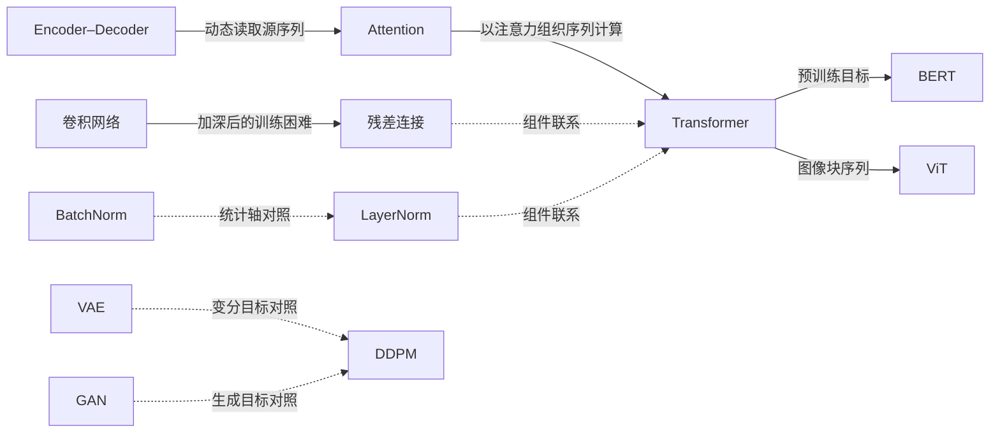

# 技术演进与论文关联

[首页](../README.md) · [论文原文索引](papers.md)

这里的关系是教学组织，不把所有箭头解释为作者之间的直接引用或历史首创认定。

| 起点 → 终点 | 关系类型 | 如何理解 | 不应推断 |
|---|---|---|---|
| VGG → ResNet | 问题延续 | 网络更深之后，训练难度成为关键问题之一 | ResNet 只是增加层数 |
| BN ↔ LN | 方法对照 | 归一化统计范围从批次对照到单样本特征 | LN 在每个任务都优于 BN |
| Encoder–Decoder → [Bahdanau Attention](../notes/bahdanau-attention.md) | 信息读取方式 | 每个解码步骤动态聚合源端表示 | 有注意力就不再需要序列编码器 |
| [Bahdanau Attention](../notes/bahdanau-attention.md) → Transformer | 计算组织变化 | 从递归模型中的注意力走向主要依靠注意力的序列架构 | 两者注意力打分函数完全一样 |
| ResNet / LN → Transformer | 组件联系 | 残差连接与层归一化用于子层组织 | 相同组件就保证相同训练性质 |
| [Transformer](../notes/transformer.md) → [BERT](../notes/bert.md) | 预训练任务 | 双向可见性、输入扰动和监督位置是三个不同选择 | 去掉因果掩码就复现了 BERT，或 MLM 等于下一词预测 |
| Transformer → ViT | 输入表示迁移 | 图像块嵌入构成序列 | 任何规模数据下都优于 CNN |
| 视觉/文本编码器 → CLIP | 监督与目标 | 学习图文配对的对比表示 | CLIP 本身就是图像生成器 |
| 预训练模型 → LoRA | 参数适配 | 用低秩增量适配冻结权重 | 不改变参数化之外的所有训练成本 |
| [Adam](../notes/adam.md) → [AdamW](../notes/adamw.md) | 优化与正则化 | 衰减不进入一阶/二阶矩；比较实现前统一学习率与衰减系数约定 | L2 与解耦衰减总等价，或解耦后衰减量就与学习率无关 |
| [VAE](../notes/vae.md) ↔ [DDPM](../notes/ddpm.md) | 概率建模对照 | 学习近似后验与固定前向加噪链的变分目标对照 | DDPM 只是给 VAE 更换编码器 |
| [VAE](../notes/vae.md) → [输入跳跃](../notes/vae-input-skip.md) | 评价问题延续 | 先写出归一化似然，再区分重构坐标与生成分布 | MSE 降低必然改善生成质量 |
| Adam → [输入跳跃](../notes/vae-input-skip.md) | 优化联系 | 等价参数表示可能具有不同更新轨迹；训练部分未本地验证 | 分布等价就保证重新训练结果相同 |
| GAN ↔ DDPM | 生成目标对照 | 对抗目标与噪声预测目标的差异 | 后发表的方法对所有指标都更好 |

关系依据分别来自对应原论文的方法段落；精读页给出具体章节。表中的阅读顺序和“不应推断”是本项目的教学解释。

## 关系概览

实线表示问题延续或应用方向，虚线表示组件联系或教学对照。具体含义与边界以上表为准。

## 用同一组问题比较论文

1. 输入、输出和训练监督分别是什么？
2. 哪个算子、目标或参数化发生变化？
3. 保持不变的对照条件有哪些？
4. 结论是在训练速度、泛化、生成质量，还是计算成本上成立？
5. 我们的小实验隔离了哪个因素，还有什么没有验证？

例如比较 BN/LN 时先固定输入和仿射参数，仅改变统计轴；比较视觉架构时若训练数据、增强、算力同时改变，就不能直接作单因素归因。
